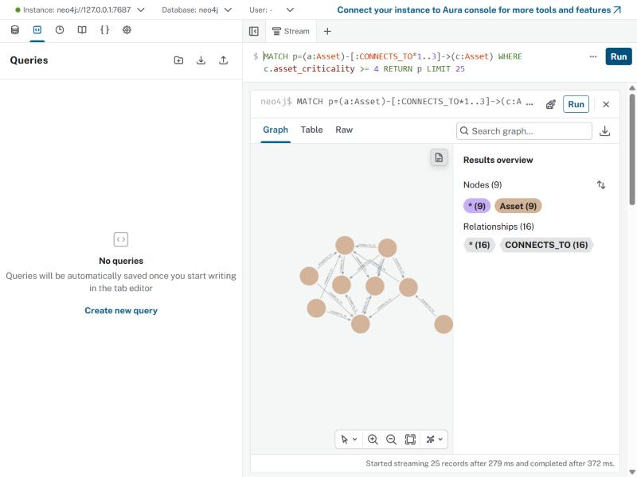
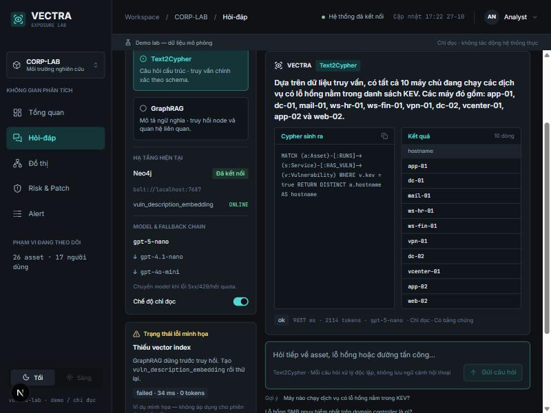
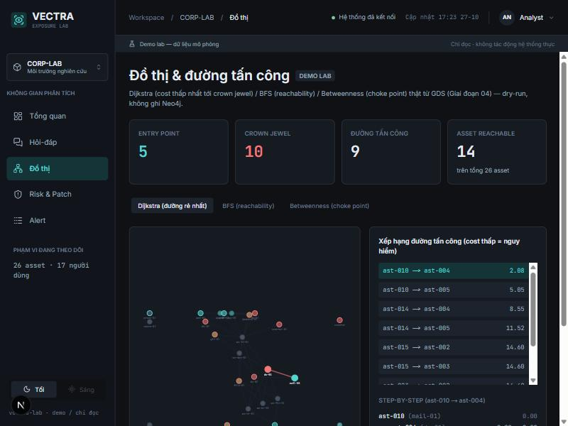

# Đồ thị tri thức an ninh — Demo VinSOC

Xem [CLAUDE.md](CLAUDE.md) để biết mục tiêu, tech stack và cấu trúc thư mục đầy đủ.

> **Demo cá nhân** — dữ liệu **mô phỏng**, chạy lab local. Trục: **đồ thị + LLM + kỹ thuật dữ liệu** cho bài toán Exposure Management / Attack Path Prediction.

## Tổng quan

Pipeline end-to-end: thu thập & chuẩn hóa dữ liệu an ninh đa nguồn → entity resolution → **đồ thị tri thức** (Neo4j + GDS) → tìm kiếm log (OpenSearch) → **lớp LLM hỏi-đáp tiếng Việt** (Text2Cypher + GraphRAG tự viết, không dùng LangChain) → **attack path & risk scoring**, kèm **eval harness** đo chất lượng + chi phí + độ trễ.

### Kiến trúc

```
[nguồn giả lập: Nmap/log/AD/HR] + [NVD/EPSS/KEV: API thật]
      │  gen_fixtures + sources
      ▼
 normalized/*.json ──► entity_resolution (55 asset→26, 31 user→17 canonical)
      │
      ▼
 Neo4j (Schema v2, ~160 node) ◄── graph_rules (CONNECTS_TO/ADMIN_TO: GIẢ ĐỊNH demo)
   │  ├─► risk_scoring : CVSS×EPSS/KEV×criticality×reachable → ghi CONNECTS_TO.cost
   │  ├─► attack_path  : GDS Dijkstra/BFS/betweenness → đường tấn công + choke point
   │  ├─► Text2Cypher  : câu hỏi VN → Cypher (validate 4 lớp) → thực thi → trả lời
   │  ├─► GraphRAG     : câu hỏi VN → embed → vector → mở rộng 1-2 hop → trả lời
   │  └─► Eval         : golden 43 câu → accuracy + $/câu + p50/p95 + judge deepeval
 OpenSearch (1653 alert doc) ◄─ index_alerts ; join_neo4j nối qua canonical_id
```

### Kết quả đo THẬT (chạy live trên Docker — xem [ket-qua-eval.md](docs/00-tong-quan/ket-qua-eval.md))

| Hạng mục | Số đo |
|---|---|
| Text2Cypher execution accuracy | **16/20 (80%)** |
| GraphRAG execution accuracy | **13/15 (87%)** |
| Chi phí | ~**$0.00026/câu** (gpt-4o-mini) |
| Độ trễ | Text2Cypher p50 **4.0s**; GraphRAG p50 **3.8s** |
| Adversarial 8 câu | **8/8 dữ liệu an toàn** (node 160→160); còn 1 injection leak |
| Judge GraphRAG (deepeval) | answer_relevancy **1.0**, faithfulness 0.68, contextual_relevancy 0.06 |

LLM dùng **fallback chain theo giá** `gpt-5-nano → gpt-4.1-nano → gpt-4o-mini` (env `LLM_MODEL_CHAIN`).

### Giả định vs Đo thật (đọc trước khi đánh giá)

| Phần | Thật | Giả định / mô phỏng |
|---|---|---|
| Dữ liệu nguồn | gọi NVD/EPSS/KEV **API thật** | Nmap/log/AD/HR **sinh giả** (`gen_fixtures`) |
| Đồ thị | node + property từ dữ liệu | `CONNECTS_TO`/`ADMIN_TO`/CVE→Service **suy từ rule viết tay** |
| Thuật toán | GDS Dijkstra/BFS/betweenness **chạy thật** | — |
| LLM | Text2Cypher/GraphRAG/Eval **chạy thật** qua gateway | accuracy đo 1 lần, golden nhỏ (43 câu) |
| Attack path | tính thật từ `cost` | **phản ánh giả định rule**, không phải quan hệ đo được |

→ Đây là **demo học tập trên dữ liệu mô phỏng**, nhấn phương pháp (đồ thị + LLM), **không** phải phát hiện lỗ hổng trong hệ thống thật.

### Ảnh & demo

**Đồ thị attack path (Neo4j Browser)** — đường `CONNECTS_TO` tới asset `asset_criticality ≥ 4`:



**UI web (Next.js + FastAPI)** — màn Hỏi-đáp: Text2Cypher chạy thật, trả lời câu hỏi tiếng Việt kèm Cypher sinh ra + kết quả + nhãn "Có bằng chứng", token/độ trễ/model thật (fallback chain `gpt-5-nano → gpt-4.1-nano → gpt-4o-mini`):



**Màn Đồ thị & đường tấn công** — KPI + đồ thị Asset/CONNECTS_TO tự vẽ (SVG) + xếp hạng đường tấn công từ GDS thật (Dijkstra/BFS/Betweenness, dry-run):



> UI Streamlit nhỏ (`src/ui/app.py`) vẫn giữ làm bản demo tối giản (xem mục 6).

---

File này ghi cách chạy phần đã code (bên dưới).

## Chạy local bằng Docker

Cách nhanh nhất để dựng toàn bộ hạ tầng + nạp dữ liệu. **Chỉ dùng local demo**: Neo4j no-auth và OpenSearch tắt security plugin, mọi port bind `127.0.0.1` — không expose ra ngoài máy.

### Yêu cầu
- Docker Desktop (Compose v2), ~2 GB RAM trống; lần đầu cần mạng (tải image + plugin GDS).
- Python 3.12+ và deps: `pip install -r requirements.txt` rồi `pip install -e .` (cài package `secgraph` ở chế độ editable — nhờ vậy mọi lệnh chạy bằng `python -m secgraph...` mà không cần `PYTHONPATH`/`sys.path`).
- PowerShell 5.1+ (để chạy `scripts/run_pipeline.ps1`).

### 1. Cấu hình `.env`
```bash
cp .env.example .env
```
- Neo4j no-auth: **để trống** `NEO4J_PASSWORD` (script tự dùng `auth=None`).
- `NVD_API_KEY` (tùy chọn): nhanh hơn khi gọi NVD lần đầu; có cache nên thường không cần.
- Phần LLM (chỉ Text2Cypher / GraphRAG / eval cần — **bạn tự điền gateway/API key của mình**, không có sẵn): `OPENAI_API_KEY`, `OPENAI_BASE_URL`, `TEXT2CYPHER_MODEL`, `EMBEDDING_MODEL`. Không commit `.env`.

### 2. Dựng hạ tầng
```bash
docker compose up -d
docker compose ps        # chờ cả neo4j-sec và opensearch-sec ở trạng thái "healthy" (Neo4j lần đầu ~1–2 phút do tải GDS)
```
Phiên bản: Neo4j `5.26-community` + GDS 2.13.x (cài qua `NEO4J_PLUGINS`), OpenSearch `2.17.1`. Kiểm GDS: `docker exec neo4j-sec cypher-shell "RETURN gds.version();"`. Nếu GDS tải về lệch 2.13.x, pin bằng cách mount jar (xem comment trong `docker-compose.yml`).

### 3. Nạp toàn bộ pipeline
```powershell
powershell -ExecutionPolicy Bypass -File scripts/run_pipeline.ps1
```
Thứ tự: fixtures + chuẩn hóa nguồn (`gen_fixtures.py`, `sources.py`) → entity resolution → `load_graph.py --reset` (**xóa dữ liệu Neo4j cũ**) → `index_alerts.py` → `risk_scoring.py` (ghi `CONNECTS_TO.cost`, exposure/criticality) → `attack_path.py` → (tùy chọn) GraphRAG `--create-index`. Bước 1–6 **không cần** env LLM; bước GraphRAG cần `OPENAI_API_KEY`, `OPENAI_BASE_URL`, `EMBEDDING_MODEL`. Tham số: `-SkipRegenerate`, `-SkipReset`, `-SkipAttackPath`, `-WithGraphRag`, `-DryRun`.

### 4. Chạy từng module
Các lệnh dưới cần Neo4j đã nạp (bước 3); Text2Cypher/GraphRAG/eval cần env LLM trong shell (set tay hoặc nạp `.env`).
```bash
python -m secgraph.llm.text2cypher.text2cypher "Máy nào chạy dịch vụ có lỗ hổng nằm trong KEV?"
python -m secgraph.llm.graphrag.graphrag_demo --create-index        # 1 lần (hoặc dùng -WithGraphRag ở trên)
python -m secgraph.llm.graphrag.graphrag_demo "<câu hỏi tiếng Việt>"
python -m secgraph.analysis.risk.risk_scoring --dry-run             # chỉ in bảng, không ghi cost
python -m secgraph.analysis.attack_path.attack_path --top 10
python -m secgraph.eval.eval_harness --pipeline all                 # gọi LLM thật, tốn token
```
Nếu import lỗi (`ModuleNotFoundError: secgraph`), chạy `pip install -e .` ở gốc repo (cài package `secgraph` editable).

### 5. Test
```bash
python -m pytest                          # unit, không cần service (mặc định bỏ marker integration)
python -m pytest -m integration           # cần Neo4j + OpenSearch đang chạy; một số test cần thêm env LLM
```
- 2 test phá hủy dữ liệu cần `ALLOW_DESTRUCTIVE_TESTS=1` (PowerShell: `$env:ALLOW_DESTRUCTIVE_TESTS="1"`) — chúng xóa dữ liệu Neo4j, nạp lại bằng `run_pipeline.ps1` sau đó.
- `eval_harness.py --include-adversarial` bắn câu xóa/tạo/SET thật vào Neo4j đang chạy (chỉ an toàn nhờ validator + READ-mode) — mặc định TẮT, chỉ bật khi chủ ý.

### 6. UI demo (Streamlit, tùy chọn)
```bash
pip install streamlit          # không nằm trong requirements.txt (chỉ cho UI demo)
streamlit run src/secgraph/ui/app.py    # mở http://localhost:8501
```
Giao diện hỏi-đáp tiếng Việt: chọn pipeline (Text2Cypher / GraphRAG), nhập câu hỏi → xem câu trả lời, Cypher sinh ra, kết quả, độ trễ + token. Cần Neo4j đã nạp pipeline (bước 3) + env LLM trong `.env`; GraphRAG cần vector index (`python -m secgraph.llm.graphrag.graphrag_demo --create-index`).

### 6b. UI web mới (Next.js + FastAPI, dựng từ thiết kế Figma)

Dashboard dark-theme đầy đủ sidebar/topbar với **cả 5 trang đã code**: Tổng quan (`GET /overview`), Hỏi-đáp (`POST /ask`), Đồ thị & đường tấn công (`GET /attack-path`), Risk & Patch (`GET /risk`), Alert & tìm kiếm log (`GET /alerts`). Backend FastAPI dùng chung logic với Streamlit qua `src/pipelines/service.py` (framework-agnostic), mọi endpoint chỉ-đọc (risk chạy dry-run, attack path chỉ `gds.*.stream` + drop projection — không ghi Neo4j), không có bộ nhớ hội thoại (mỗi câu hỏi 1 request độc lập). Số liệu hạ tầng (Neo4j/vector/model chain/đếm node) là thật, không fake; cờ `pagerank_wired=false`/`read_only=true` phơi rõ trên UI.

```bash
# 1) Backend FastAPI (cần Neo4j đã nạp pipeline + env LLM trong .env, giống bước 6)
uvicorn secgraph.api.main:app --reload --port 8000

# 2) Frontend Next.js (terminal khác)
cd web
npm install        # lần đầu
cp env.example .env.local   # tùy chọn — mặc định đã trỏ localhost:8000
npm run dev         # mở http://localhost:3000 (redirect sang /qa)
```
`GET /health` cho trạng thái Neo4j/vector index/model chain/số asset-user thật (không fake). Lỗi backend (thiếu env LLM, Neo4j down, thiếu vector index...) hiển thị trực tiếp trong UI dưới dạng card lỗi.

### 7. Dọn dẹp
```bash
docker compose down        # tắt, giữ dữ liệu (named volume)
docker compose down -v     # tắt và xóa toàn bộ dữ liệu Neo4j + OpenSearch
```
