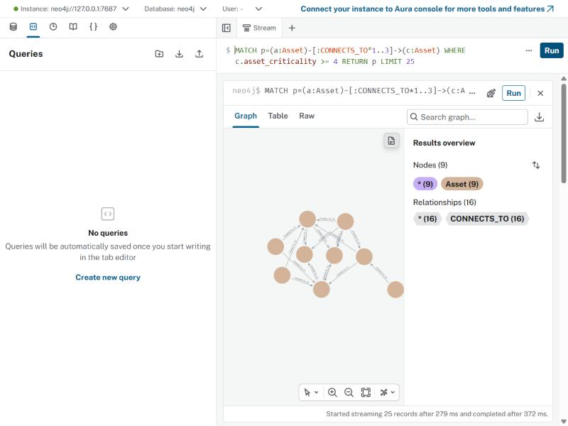
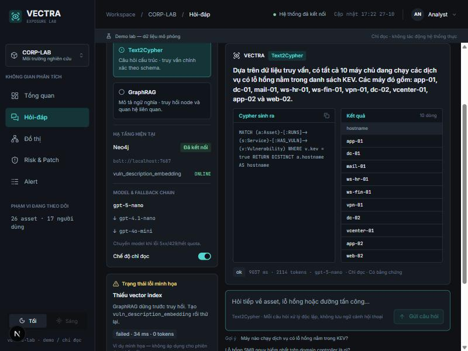
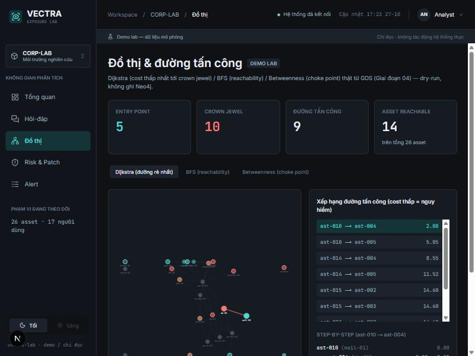

# Đồ thị tri thức an ninh — Demo VinSOC

Xem [CLAUDE.md](CLAUDE.md) để biết mục tiêu, tech stack và cấu trúc thư mục đầy đủ.

> **Demo cá nhân** — dữ liệu **mô phỏng**, chạy lab local. Trục: **đồ thị + LLM + kỹ thuật dữ liệu** cho bài toán Exposure Management / Attack Path Prediction.

## Tổng quan

Pipeline end-to-end: thu thập & chuẩn hóa dữ liệu an ninh đa nguồn → entity resolution → **đồ thị tri thức** (Neo4j + GDS) → tìm kiếm log (OpenSearch) → **lớp LLM hỏi-đáp tiếng Việt** (Text2Cypher + GraphRAG tự viết, không dùng LangChain) → **attack path & risk scoring**, kèm **eval harness** đo chất lượng + chi phí + độ trễ.

### Kiến trúc

```
[nguồn giả lập: Nmap/log/AD/HR] + [NVD/EPSS/KEV: API thật]
      │  gen_fixtures + sources
      ▼
 normalized/*.json ──► entity_resolution (55 asset→26, 31 user→17 canonical)
      │
      ▼
 Neo4j (Schema v2, ~160 node) ◄── graph_rules (CONNECTS_TO/ADMIN_TO: GIẢ ĐỊNH demo)
   │  ├─► risk_scoring : CVSS×EPSS/KEV×criticality×reachable → ghi CONNECTS_TO.cost
   │  ├─► attack_path  : GDS Dijkstra/BFS/betweenness → đường tấn công + choke point
   │  ├─► Text2Cypher  : câu hỏi VN → Cypher (validate 4 lớp) → thực thi → trả lời
   │  ├─► GraphRAG     : câu hỏi VN → embed → vector → mở rộng 1-2 hop → trả lời
   │  └─► Eval         : golden 43 câu → accuracy + $/câu + p50/p95 + judge deepeval
 OpenSearch (1653 alert doc) ◄─ index_alerts ; join_neo4j nối qua canonical_id
```

### Kết quả đo THẬT (chạy live trên Docker — xem [ket-qua-eval.md](docs/00-tong-quan/ket-qua-eval.md))

| Hạng mục | Số đo |
|---|---|
| Text2Cypher execution accuracy | **16/20 (80%)** |
| GraphRAG execution accuracy | **13/15 (87%)** |
| Chi phí | ~**$0.00026/câu** (gpt-4o-mini) |
| Độ trễ | Text2Cypher p50 **4.0s**; GraphRAG p50 **3.8s** |
| Adversarial 8 câu | **8/8 dữ liệu an toàn** (node 160→160); còn 1 injection leak |
| Judge GraphRAG (deepeval) | answer_relevancy **1.0**, faithfulness 0.68, contextual_relevancy 0.06 |

LLM dùng **fallback chain theo giá** `gpt-5-nano → gpt-4.1-nano → gpt-4o-mini` (env `LLM_MODEL_CHAIN`).

### Giả định vs Đo thật (đọc trước khi đánh giá)

| Phần | Thật | Giả định / mô phỏng |
|---|---|---|
| Dữ liệu nguồn | gọi NVD/EPSS/KEV **API thật** | Nmap/log/AD/HR **sinh giả** (`gen_fixtures`) |
| Đồ thị | node + property từ dữ liệu | `CONNECTS_TO`/`ADMIN_TO`/CVE→Service **suy từ rule viết tay** |
| Thuật toán | GDS Dijkstra/BFS/betweenness **chạy thật** | — |
| LLM | Text2Cypher/GraphRAG/Eval **chạy thật** qua gateway | accuracy đo 1 lần, golden nhỏ (43 câu) |
| Attack path | tính thật từ `cost` | **phản ánh giả định rule**, không phải quan hệ đo được |

→ Đây là **demo học tập trên dữ liệu mô phỏng**, nhấn phương pháp (đồ thị + LLM), **không** phải phát hiện lỗ hổng trong hệ thống thật.

### Ảnh & demo

**Đồ thị attack path (Neo4j Browser)** — đường `CONNECTS_TO` tới asset `asset_criticality ≥ 4`:



**UI web (Next.js + FastAPI)** — màn Hỏi-đáp: Text2Cypher chạy thật, trả lời câu hỏi tiếng Việt kèm Cypher sinh ra + kết quả + nhãn "Có bằng chứng", token/độ trễ/model thật (fallback chain `gpt-5-nano → gpt-4.1-nano → gpt-4o-mini`):



**Màn Đồ thị & đường tấn công** — KPI + đồ thị Asset/CONNECTS_TO tự vẽ (SVG) + xếp hạng đường tấn công từ GDS thật (Dijkstra/BFS/Betweenness, dry-run):



> UI Streamlit nhỏ (`src/ui/app.py`) vẫn giữ làm bản demo tối giản (xem mục 6).

---

File này ghi cách chạy phần đã code (bên dưới).

## Chạy local bằng Docker

Cách nhanh nhất để dựng toàn bộ hạ tầng + nạp dữ liệu. **Chỉ dùng local demo**: Neo4j no-auth và OpenSearch tắt security plugin, mọi port bind `127.0.0.1` — không expose ra ngoài máy.

### Yêu cầu
- Docker Desktop (Compose v2), ~2 GB RAM trống; lần đầu cần mạng (tải image + plugin GDS).
- Python 3.12+ và deps: `pip install -r requirements.txt` rồi `pip install -e .` (cài package `secgraph` ở chế độ editable — nhờ vậy mọi lệnh chạy bằng `python -m secgraph...` mà không cần `PYTHONPATH`/`sys.path`).
- PowerShell 5.1+ (để chạy `scripts/run_pipeline.ps1`).

### 1. Cấu hình `.env`
```bash
cp .env.example .env
```
- Neo4j no-auth: **để trống** `NEO4J_PASSWORD` (script tự dùng `auth=None`).
- `NVD_API_KEY` (tùy chọn): nhanh hơn khi gọi NVD lần đầu; có cache nên thường không cần.
- Phần LLM (chỉ Text2Cypher / GraphRAG / eval cần — **bạn tự điền gateway/API key của mình**, không có sẵn): `OPENAI_API_KEY`, `OPENAI_BASE_URL`, `TEXT2CYPHER_MODEL`, `EMBEDDING_MODEL`. Không commit `.env`.

### 2. Dựng hạ tầng
```bash
docker compose up -d
docker compose ps        # chờ cả neo4j-sec và opensearch-sec ở trạng thái "healthy" (Neo4j lần đầu ~1–2 phút do tải GDS)
```
Phiên bản: Neo4j `5.26-community` + GDS 2.13.x (cài qua `NEO4J_PLUGINS`), OpenSearch `2.17.1`. Kiểm GDS: `docker exec neo4j-sec cypher-shell "RETURN gds.version();"`. Nếu GDS tải về lệch 2.13.x, pin bằng cách mount jar (xem comment trong `docker-compose.yml`).

### 3. Nạp toàn bộ pipeline
```powershell
powershell -ExecutionPolicy Bypass -File scripts/run_pipeline.ps1
```
Thứ tự: fixtures + chuẩn hóa nguồn (`gen_fixtures.py`, `sources.py`) → entity resolution → `load_graph.py --reset` (**xóa dữ liệu Neo4j cũ**) → `index_alerts.py` → `risk_scoring.py` (ghi `CONNECTS_TO.cost`, exposure/criticality) → `attack_path.py` → (tùy chọn) GraphRAG `--create-index`. Bước 1–6 **không cần** env LLM; bước GraphRAG cần `OPENAI_API_KEY`, `OPENAI_BASE_URL`, `EMBEDDING_MODEL`. Tham số: `-SkipRegenerate`, `-SkipReset`, `-SkipAttackPath`, `-WithGraphRag`, `-DryRun`.

### 4. Chạy từng module
Các lệnh dưới cần Neo4j đã nạp (bước 3); Text2Cypher/GraphRAG/eval cần env LLM trong shell (set tay hoặc nạp `.env`).
```bash
python -m secgraph.llm.text2cypher.text2cypher "Máy nào chạy dịch vụ có lỗ hổng nằm trong KEV?"
python -m secgraph.llm.graphrag.graphrag_demo --create-index        # 1 lần (hoặc dùng -WithGraphRag ở trên)
python -m secgraph.llm.graphrag.graphrag_demo "<câu hỏi tiếng Việt>"
python -m secgraph.analysis.risk.risk_scoring --dry-run             # chỉ in bảng, không ghi cost
python -m secgraph.analysis.attack_path.attack_path --top 10
python -m secgraph.eval.eval_harness --pipeline all                 # gọi LLM thật, tốn token
```
Nếu import lỗi (`ModuleNotFoundError: secgraph`), chạy `pip install -e .` ở gốc repo (cài package `secgraph` editable).

### 5. Test
```bash
python -m pytest                          # unit, không cần service (mặc định bỏ marker integration)
python -m pytest -m integration           # cần Neo4j + OpenSearch đang chạy; một số test cần thêm env LLM
```
- 2 test phá hủy dữ liệu cần `ALLOW_DESTRUCTIVE_TESTS=1` (PowerShell: `$env:ALLOW_DESTRUCTIVE_TESTS="1"`) — chúng xóa dữ liệu Neo4j, nạp lại bằng `run_pipeline.ps1` sau đó.
- `eval_harness.py --include-adversarial` bắn câu xóa/tạo/SET thật vào Neo4j đang chạy (chỉ an toàn nhờ validator + READ-mode) — mặc định TẮT, chỉ bật khi chủ ý.

### 6. UI demo (Streamlit, tùy chọn)
```bash
pip install streamlit          # không nằm trong requirements.txt (chỉ cho UI demo)
streamlit run src/secgraph/ui/app.py    # mở http://localhost:8501
```
Giao diện hỏi-đáp tiếng Việt: chọn pipeline (Text2Cypher / GraphRAG), nhập câu hỏi → xem câu trả lời, Cypher sinh ra, kết quả, độ trễ + token. Cần Neo4j đã nạp pipeline (bước 3) + env LLM trong `.env`; GraphRAG cần vector index (`python -m secgraph.llm.graphrag.graphrag_demo --create-index`).

### 6b. UI web mới (Next.js + FastAPI, dựng từ thiết kế Figma)

Dashboard dark-theme đầy đủ sidebar/topbar với **cả 5 trang đã code**: Tổng quan (`GET /overview`), Hỏi-đáp (`POST /ask`), Đồ thị & đường tấn công (`GET /attack-path`), Risk & Patch (`GET /risk`), Alert & tìm kiếm log (`GET /alerts`). Backend FastAPI dùng chung logic với Streamlit qua `src/pipelines/service.py` (framework-agnostic), mọi endpoint chỉ-đọc (risk chạy dry-run, attack path chỉ `gds.*.stream` + drop projection — không ghi Neo4j), không có bộ nhớ hội thoại (mỗi câu hỏi 1 request độc lập). Số liệu hạ tầng (Neo4j/vector/model chain/đếm node) là thật, không fake; cờ `pagerank_wired=false`/`read_only=true` phơi rõ trên UI.

```bash
# 1) Backend FastAPI (cần Neo4j đã nạp pipeline + env LLM trong .env, giống bước 6)
uvicorn secgraph.api.main:app --reload --port 8000

# 2) Frontend Next.js (terminal khác)
cd web
npm install        # lần đầu
cp env.example .env.local   # tùy chọn — mặc định đã trỏ localhost:8000
npm run dev         # mở http://localhost:3000 (redirect sang /qa)
```
`GET /health` cho trạng thái Neo4j/vector index/model chain/số asset-user thật (không fake). Lỗi backend (thiếu env LLM, Neo4j down, thiếu vector index...) hiển thị trực tiếp trong UI dưới dạng card lỗi.

### 7. Dọn dẹp
```bash
docker compose down        # tắt, giữ dữ liệu (named volume)
docker compose down -v     # tắt và xóa toàn bộ dữ liệu Neo4j + OpenSearch
```
Lưu ý: `NEO4J_AUTH=none` chỉ có hiệu lực khi volume trống; nếu từng tạo volume có mật khẩu, dùng `down -v` rồi `up -d` lại.

> Các mục "Giai đoạn 01/02/03" bên dưới là hướng dẫn chạy tay từng module (kể cả `docker run` thủ công — tương đương compose, đừng chạy song song vì trùng port/tên container).

## Giai đoạn 01 — Neo4j & Cypher (schema v1)

### 1. Dựng Neo4j + GDS
```bash
docker run -d --name neo4j-sec \
  -p 127.0.0.1:7474:7474 -p 127.0.0.1:7687:7687 \
  -e NEO4J_AUTH=none \
  -e NEO4J_PLUGINS='["graph-data-science"]' \
  -v neo4j_sec_data:/data \
  neo4j:5.26-community
```
`NEO4J_AUTH=none` → không cần mật khẩu (demo local, bind 127.0.0.1). `NEO4J_PLUGINS` tự tải GDS 2.13.x khớp Neo4j 5.26 (lần đầu cần mạng). Chờ log `Started.` rồi kiểm:
```bash
docker exec neo4j-sec cypher-shell "RETURN gds.version();"   # ra 2.13.x
```
Hoặc mở `http://localhost:7474` (không cần đăng nhập), chạy `RETURN 1`.

> `NEO4J_AUTH=none` chỉ áp dụng khi volume còn trống (lần đầu). Đã lỡ tạo DB có mật khẩu và muốn bỏ auth mà giữ data: dùng `-e NEO4J_dbms_security_auth__enabled=false` thay cho `NEO4J_AUTH=none`.

### 2. Cấu hình
```bash
cp .env.example .env
# Neo4j no-auth: để trống NEO4J_PASSWORD (script tự dùng auth=None)
pip install -r requirements.txt
```

### 3. Nạp dữ liệu & xác minh (schema v1)
```bash
python -m secgraph.graph.seed_graph
```
Script tạo constraint, nạp schema v1 + dữ liệu mẫu (idempotent — chạy lại nhiều lần vẫn ra cùng số liệu), rồi in: số node/relationship theo nhãn/loại, danh sách user tới được `db-01` trong tối đa 3 và 5 bước, kết quả xác minh cú pháp quantified relationship/`SHORTEST`, và plan `PROFILE` để kiểm index.

Chạy lại lần hai để tự kiểm tính idempotent — số liệu phải giữ nguyên.

## Giai đoạn 01 — Mô hình hóa dữ liệu an ninh (schema v2)

Yêu cầu: đã chạy `seed_graph.py` ở trên (script kiểm 5 Asset trước khi chạy tiếp).
```bash
python -m secgraph.graph.model_v2
```
Migrate v1→v2: thêm `Group`/`Alert`, `MEMBER_OF`/`ADMIN_TO`/`AUTHENTICATED_TO`/`OWNS`/`TRIGGERED_ON`/`INVOLVES`, tách quyền "có thể làm" khỏi "đã quan sát". In kết quả 8 câu hỏi kiểm (mục 6.1 `docs/giai-doan-01-graph-foundations/mo-hinh-hoa-du-lieu.md`) và kiểm cấu trúc node/relationship (kỳ vọng 28/37). Idempotent — chạy lại nhiều lần vẫn ra cùng số liệu.

## Giai đoạn 01 — Thuật toán đồ thị (GDS)

Yêu cầu: Neo4j có GDS (`RETURN gds.version()` ra 2.13.x) và đã chạy `model_v2.py`.
```bash
python -m secgraph.graph.algo.algo_demo
```
Thêm 3 máy lab (vpn-01, jump-01, file-01) + gán `cost` 1–10 (nhỏ = dễ đi) cho 10 cạnh `CONNECTS_TO`, chiếu 2 đồ thị vào RAM (`attack` có hướng/có trọng số; `attack_u` vô hướng), rồi chạy & kiểm **BFS, Dijkstra, PageRank, Louvain, Leiden** theo bảng kết quả mong đợi (mục 6.1 `docs/giai-doan-01-graph-foundations/thuat-toan-do-thi.md`). In `OK/FAIL` từng mục.

Lưu ý: script đưa DB lên **8 Asset / 10 `CONNECTS_TO`**, nên `model_v2.py` chạy lại *sau đó* sẽ báo LỆCH số lượng (đúng thiết kế — algo là trạng thái cuối Giai đoạn 01). Query dọn để quay lại dữ liệu bài trước nằm ở cuối `algo_demo.py`.

## Giai đoạn 02 — Module 1: Parser nguồn dữ liệu

Không cần Neo4j. Chỉ cần `pip install -r requirements.txt` (thêm `requests`). Xuất 7 file JSON chuẩn hóa vào `src/ingestion/normalized/` (chưa nạp Neo4j — việc đó sau Entity resolution).
```bash
python -m secgraph.ingestion.gen_fixtures   # (tùy chọn) sinh lại data/sample_nmap.xml + sample_logs.jsonl
python -m secgraph.ingestion.sources
```
`gen_fixtures.py` sinh **toàn bộ dữ liệu nguồn giả** vào `data/` (tất định, đã commit): `sample_nmap.xml`, `sample_logs.jsonl`, `sample_ad.json` (AD view), `sample_hr.json` (HR view), `er_truth.json` (nhãn eval cho Module 2). `sources.py` chuẩn hóa mọi nguồn → 7 file, mỗi record có field `source`:
- **Nmap** → asset + service; **Identity** (seed=42) → user/account/membership; **Log** → alert + quan sát asset; **AD/HR** → asset/user góc nhìn biến thể.
- `assets.json` và `users.json` **đa-nguồn** (asset: nmap+ad+log; user: idp+hr) — để Module 2 có bản ghi trùng mà gộp.
- **NVD + EPSS + CISA KEV**: gọi **API công khai thật**, gộp theo `cve_id`. Response cache ở `src/ingestion/cache/` (đã commit) → lần sau chạy **offline/tức thì**, idempotent.

NVD không cần key (tự giới hạn 6s/CVE, ~28 CVE ≈ 3 phút lần đầu); có key free thì đặt `NVD_API_KEY` để nhanh hơn. Dùng `--refresh` để xóa cache và gọi API lại. In số record 7 file + completeness (bao nhiêu CVE đủ cả 3 nguồn) + kiểm CVE-2021-44228.

## Giai đoạn 02 — Module 2: Entity resolution

Cần `rapidfuzz` (đã trong `requirements.txt`). Đọc `normalized/{assets,users,alerts}.json`, xuất vào `src/ingestion/resolved/`.
```bash
python -m secgraph.ingestion.resolution.entity_resolution
```
**Thuần xử lý**: đọc `normalized/{assets,users}.json` (đã đa-nguồn từ Module 1) + `data/er_truth.json`, không tự sinh data. Gộp bản ghi nhiều nguồn về cùng thực thể → `canonical_id`:
- **Asset — 3 nguồn** (nmap+ad+log) union-find gộp cả 3; **User — 2 nguồn** (idp+hr).
- Pipeline: blocking (2 ký tự đầu) → best-match (exact trước, rồi `fuzz.ratio`/`token_sort_ratio`) → ngưỡng → union-find → crosswalk giữ mọi id gốc.

**Ngưỡng match=95** (không phải 85), chọn theo `security.md` (false merge nguy hiểm hơn false split); cặp 70–94 vào `review_queue.json` cho người xác nhận tay (gồm bẫy `ws-hr-01`↔`ws-hr-02`). Xuất: `crosswalk.json`, `review_queue.json`, `decisions.json` (audit trail), `eval.json` (precision/recall/F1 ở 3 ngưỡng). `canonical_id` sẽ là khóa MERGE khi nạp Neo4j (bước load, ngay dưới đây).

## Giai đoạn 02 — Loader: nạp pipeline vào Neo4j

Thay thế toy graph Giai đoạn 01 bằng dữ liệu pipeline thật (26 Asset, 33 Service, 28 Vulnerability, 17 User, 16 Account, 5 Group, 30 Alert — khóa MERGE là `canonical_id`, idempotent). Cần đã chạy Module 1+2 ở trên.
```bash
python -m secgraph.graph.load_graph --reset
```
`--reset` xóa sạch dữ liệu Neo4j hiện có (toy graph `seed_graph.py`/`model_v2.py`/`algo_demo.py`, kể cả GDS projection `attack`/`attack_u`) trước khi nạp — **chỉ chạy khi chắc chắn muốn bỏ dữ liệu cũ**. Không có `--reset`: nếu DB có Asset/User thiếu `canonical_id` (toy data cũ), script chặn và không ghi gì (an toàn khi chạy lại nhầm). Sau `--reset` lần đầu, các lần sau chạy `python -m secgraph.graph.load_graph` (không cờ) để nạp lại idempotent.

In số node/relationship theo nhãn/loại, kiểm khớp đúng 158 node / 243 relationship, `SHOW CONSTRAINTS` có `asset_canonical_id`/`user_canonical_id`, cảnh báo node "stale" (canonical_id không còn trong crosswalk). `ADMIN_TO`/CVE→`Service`/`CONNECTS_TO` suy diễn từ bảng rule viết tay trong `src/graph/graph_rules.py` (**giả định nghiệp vụ demo**, không phải dữ liệu đo thật — xem `docs/giai-doan-01-graph-foundations/mo-hinh-hoa-du-lieu.md`).

> Sau bước này, `seed_graph.py`/`model_v2.py`/`algo_demo.py` không còn phản ánh đúng dữ liệu trong DB (đúng thiết kế — dữ liệu pipeline thay thế dữ liệu dạy khái niệm). Các file đó vẫn giữ nguyên làm tài liệu học, không chạy lại trên DB đã nạp pipeline.

## Giai đoạn 02 — Module 3: OpenSearch (log & alert)

Dùng cho full-text/aggregation trên alert — Neo4j không join tự động, nối tay qua `asset_canonical_id`.
```bash
docker run -d --name opensearch-sec \
  -p 127.0.0.1:9200:9200 -p 127.0.0.1:9600:9600 \
  -e discovery.type=single-node \
  -e DISABLE_SECURITY_PLUGIN=true \
  -e "OPENSEARCH_JAVA_OPTS=-Xms512m -Xmx512m" \
  opensearchproject/opensearch:2.17.1
```
`DISABLE_SECURITY_PLUGIN=true` chỉ cho demo local, bind `127.0.0.1`. Chờ container sẵn sàng (`curl http://localhost:9200`) rồi:
```bash
python -m secgraph.search.index_alerts    # nhân bản 30 alert gốc → 1653 doc (factor=50 + 120 burst + 33 scenario S2 D.3), bulk index
python -m secgraph.search.search_alerts   # 4 query bool DSL mẫu: top asset bị logon thất bại, date histogram, full-text, term text-vs-keyword
python -m secgraph.search.join_neo4j      # nối tay OpenSearch → Neo4j: top asset bị logon thất bại + CVE KEV của asset đó
```
`index_alerts.py` idempotent (`_id` tất định, chạy lại không tăng số doc). `join_neo4j.py` cần cả OpenSearch và Neo4j (Module Loader ở trên) đã chạy.

## Giai đoạn 03 — Text2Cypher

Sinh Cypher từ câu hỏi tiếng Việt bằng LLM (pipeline 6 bước tự viết: schema text sinh từ `db.schema.*` → few-shot → LLM sinh Cypher → validate 4 lớp → thực thi Neo4j → LLM diễn giải). **Neo4j Community không có RBAC** (xem `.claude/rules/security.md`) — validate app-layer 4 lớp là lớp chính thực tế chặn ghi/injection (risk-accepted cho demo, xem `docs/giai-doan-03-llm-layer/text2cypher.md`).

Cần biến môi trường (LLM qua gateway OpenAI-compatible, ví dụ shopaikey.com — không hardcode trong code):
```bash
OPENAI_API_KEY=<key của bạn>
OPENAI_BASE_URL=<base url gateway, vd https://api.shopaikey.com/v1>
TEXT2CYPHER_MODEL=<tên model gateway hỗ trợ, vd gpt-4o-mini>
```
Đặt trong `.env` (không commit) rồi `export $(...)`/`source` vào shell trước khi chạy, hoặc set trực tiếp. Chạy:
```bash
python -m secgraph.llm.text2cypher.text2cypher --check-model        # xác nhận model khả dụng qua gateway
python -m secgraph.llm.text2cypher.text2cypher "Máy nào chạy dịch vụ có lỗ hổng nằm trong KEV?"
python -m secgraph.llm.text2cypher.text2cypher "<câu hỏi>" --json    # output JSON (Text2CypherResult)
```
Cần Neo4j đã nạp dữ liệu pipeline (Module Loader ở trên) — schema text sinh từ dữ liệu thật, few-shot (`src/llm/text2cypher/few_shots.json`, 13 cặp) viết dựa trên dữ liệu đã nạp.

## Test

```bash
pip install pytest   # đã có trong requirements.txt
python -m pytest tests/ -v                 # unit, không cần Neo4j/OpenSearch/LLM (mặc định bỏ marker integration)
python -m pytest tests/ -v -m integration  # cần Neo4j + OpenSearch đang chạy (2 docker ở trên)
```
Test gắn `@pytest.mark.integration` cần service thật — `pytest.ini` tự bỏ qua chúng ở lần chạy mặc định (`addopts = -m "not integration"`). Riêng `tests/test_text2cypher_e2e.py` còn cần biến môi trường LLM (mục Text2Cypher ở trên) — tốn gọi API thật mỗi lần chạy.

## Thay đổi gần đây

Sau Giai đoạn 03 Text2Cypher đã có 20 commit cải tiến trong scope "đã hoàn thành" (Stage 01, 02, Text2Cypher). Chia thành 3 PR tuần tự — chi tiết từng commit xem [COMMIT_MESSAGES.md](COMMIT_MESSAGES.md), tóm tắt thay đổi đáng chú ý:

| # | Thay đổi | Tác động |
|---|---|---|
| 2.4 | Network "unknown" cho asset không IP | `EXPECT_NODES["Network"]`: 3 → **4**; `EXPECT_RELS["IN_NETWORK"]`: 21 → **26** |
| 2.9 | `canonical_id` prefix `ast-/usr-` | Format `asset-014` → `ast-014`, `user-003` → `usr-003`. **Cần `--reset`** |
| 3.3 | Rules YAML có `source`/`last_reviewed` | `src/graph/rules.yaml` mới, mỗi rule có metadata audit |
| 3.7 | Truncate safety net trong `to_jsonable` | `_truncate_jsonable` bị xóa, gộp vào `to_jsonable` |

**Behavior change quan trọng nhất**: commit **2.9** đổi `canonical_id` format. Sau khi merge PR2, **bắt buộc** chạy `--reset` để nạp lại toàn bộ graph. Script tự động:

```powershell
# Yêu cầu: Neo4j + OpenSearch Docker đang chạy
powershell -ExecutionPolicy Bypass -File scripts/reset_and_reload.ps1
```

Script làm 6 bước: verify service → regenerate pipeline → `--reset` → verify canonical_id → re-index OpenSearch → pytest. Tham số:
- `-SkipRegenerate`: bỏ qua bước 2 (nếu normalized/ + resolved/ đã mới)
- `-SkipTest`: bỏ qua bước 6 (integration test)
- `-DryRun`: chỉ in command, không chạy

Sau khi script chạy xong, verify cuối:
```bash
python -m pytest tests/ -v                    # 221 unit test
python -m pytest tests/ -v -m integration     # cần service thật
python -m secgraph.llm.text2cypher.text2cypher "Máy nào chạy dịch vụ có lỗ hổng KEV?"
```

Nếu gặp HĐ 04 attack path / risk scoring sau này — cần áp dụng Phương án 2 (role từ Nmap service) đã chốt cho commit `C.3`.
